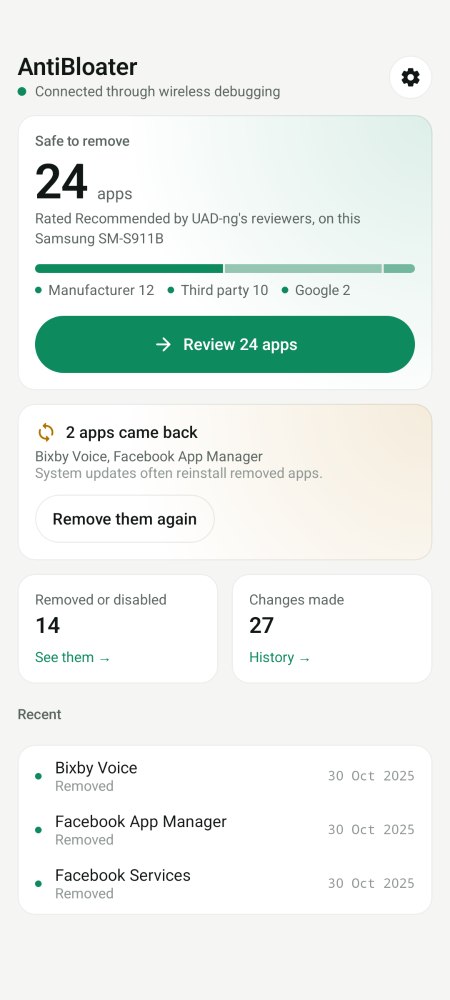
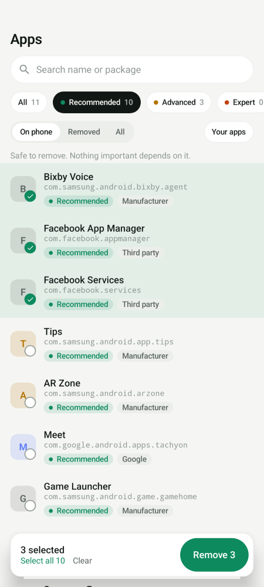
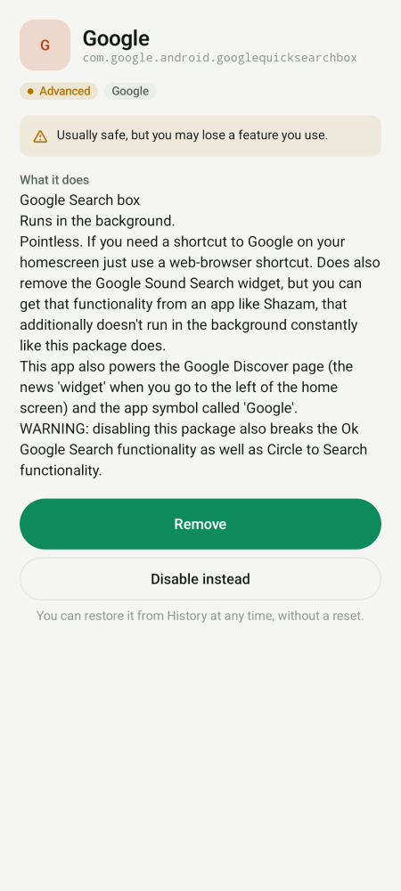
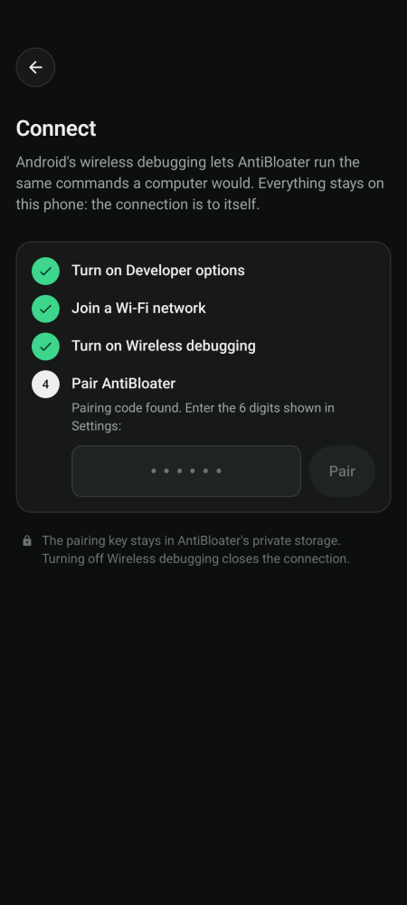
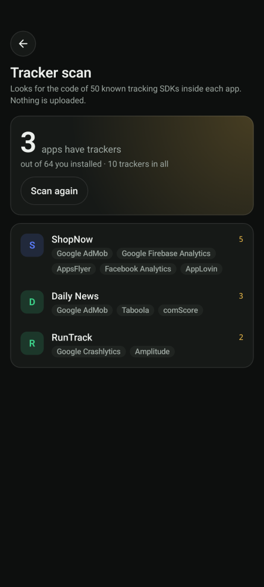
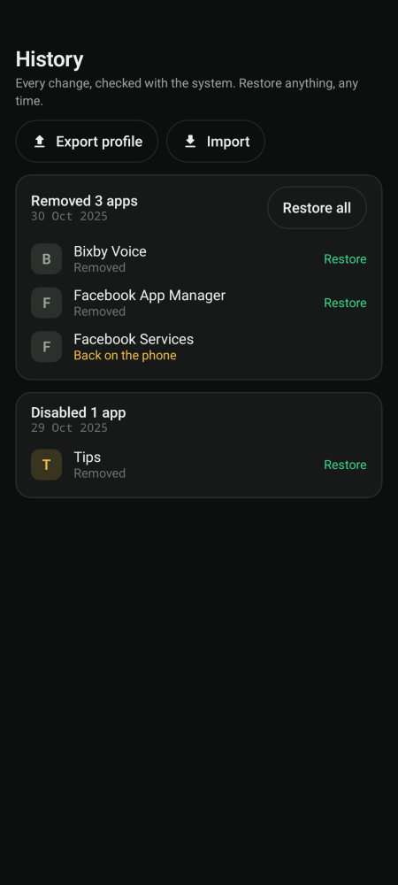
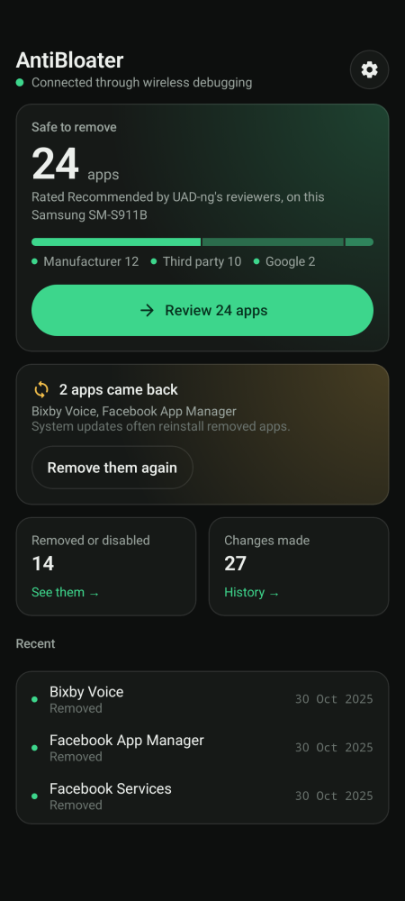

# AntiBloater

Remove the apps your phone came with, from the phone itself. No root, no computer, no Shizuku.

AntiBloater connects to your phone's own **wireless debugging**, so it can run the same `pm` commands a computer would. It knows what **5,382 preinstalled packages** do (from the [UAD-ng](https://github.com/Universal-Debloater-Alliance/universal-android-debloater-next-generation) list) and how safe each one is to remove. Everything it removes can be restored in one tap, without a factory reset.

<p>
  
  
  
  
</p>

**[Download the latest APK](https://github.com/springmusk026/AntiBloater/releases/latest)** · Android 8 or later (wireless pairing needs Android 11)

## What makes it different

- **It tells you what each package is.** Every package gets a plain description and one of four levels: *Recommended*, *Advanced*, *Expert* or *Unsafe*. Home shows how many are safe to remove on your phone, and one tap takes you to them.
- **It checks its work.** After every command, AntiBloater asks the system whether the app is really gone. Failures show adb's own error message. Only changes that actually happened go into History.
- **Everything is reversible.** Removing uses `pm uninstall -k --user 0`: the APK stays on the system partition and the app's data is kept, so Restore brings it back as it was. You can undo a whole batch at once.
- **It notices when apps come back.** System updates often reinstall removed apps. Home shows which ones came back and removes them again in one tap.
- **It guards the things that keep your phone working.** The launcher, keyboard, Settings, System UI and the adb shell itself can't be removed. *Unsafe* packages stay locked unless you unlock them in Settings, and anything riskier than *Recommended* asks before it runs.
- **Pairing works like Shizuku.** AntiBloater finds the pairing port by itself over mDNS. You type the 6-digit code into its notification without leaving Settings, and it reconnects on its own from then on.
- **Profiles.** Export what you've removed as a file and apply it to another phone, or to the same phone after a reset. Profiles from AntiBloater 1.x import too.

## Tools

<p>
  
  
  
</p>

- **Tracker scan** looks for 50 advertising, analytics and attribution SDKs inside the apps you installed. It reads the class names from each app's dex files, like Exodus Privacy, and binary-searches the sorted string table, so it takes seconds rather than minutes. Nothing is uploaded.
- **Permission audit** lists which apps hold your location, camera, microphone, contacts, SMS and more, and revokes access in one tap.
- **Background apps** shows what starts at boot, with Android's *restrict background activity* switch for each app.
- **Animation speed** sets all three system animation scales at once.

## Setting up

1. Turn on **Developer options**: Settings → About phone → tap *Build number* seven times.
2. Join any Wi-Fi network. Wireless debugging needs one, but it doesn't need internet.
3. In AntiBloater, tap **Set up connection** and follow the steps. It opens the right Settings page for you and ticks each step off as you go.

On Android 10 and older there's no wireless debugging. Run `adb tcpip 5555` from a computer once, and AntiBloater connects to that instead.

## Privacy

AntiBloater uses the internet for exactly two things: talking to your own phone over localhost through adb, and *Update package list* in Settings, which downloads the UAD-ng list from GitHub. There are no analytics, no accounts and no ads. Your pairing key and history stay in the app's private storage and are excluded from backups.

## Building

```sh
./gradlew assembleDebug            # app/build/outputs/apk/debug
./gradlew testDebugUnitTest        # unit tests + screen renders
./gradlew recordPaparazziDebug     # refresh the screenshots in app/src/test/snapshots
```

Kotlin, Jetpack Compose and Material 3, with no DI framework or database. Every screen is a stateless composable, rendered by [Paparazzi](https://github.com/cashapp/paparazzi) in light and dark for review. Pushing a `v*` tag builds, signs and publishes a release (see `.github/workflows/release.yml`).

## Credits and license

- The package descriptions and safety levels are the work of the [UAD-ng](https://github.com/Universal-Debloater-Alliance/universal-android-debloater-next-generation) contributors (GPL-3.0).
- The bundled adb binary comes from [LADB](https://github.com/tytydraco/LADB) by Tyler Nijmeh (GPL-3.0).

AntiBloater is licensed under the [GNU GPL v3.0](LICENSE).

## Also from me

- [Portside](https://github.com/springmusk026/Portside): see every dev server on your Mac, and stop it in one click.
- [Sweepside](https://github.com/springmusk026/Sweepside): reclaim the gigabytes old projects keep in `node_modules`, `.venv` and `target`.
- [Peekside](https://github.com/springmusk026/Peekside): see which apps used your Mac's microphone and camera today.
